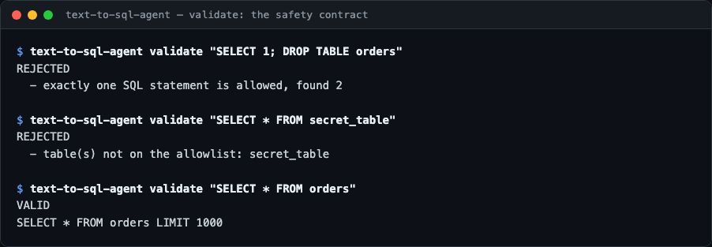
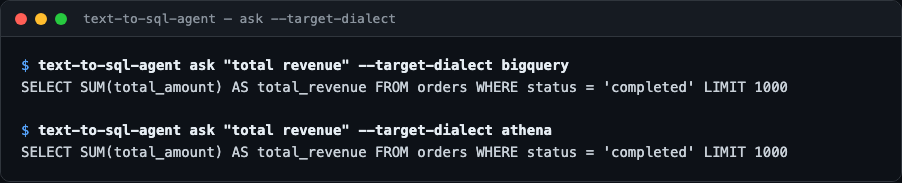
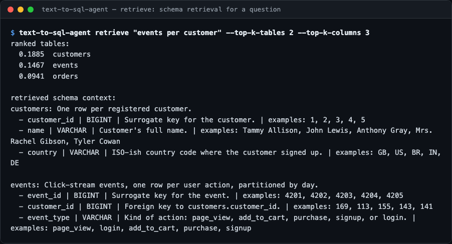
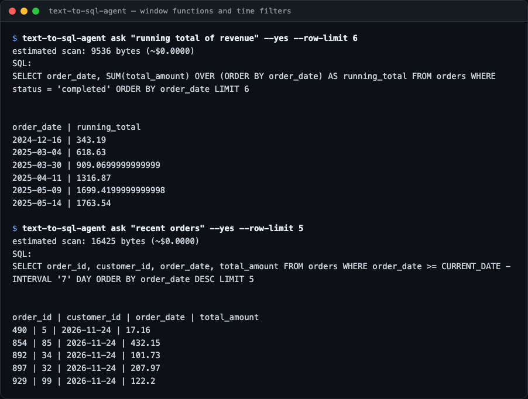
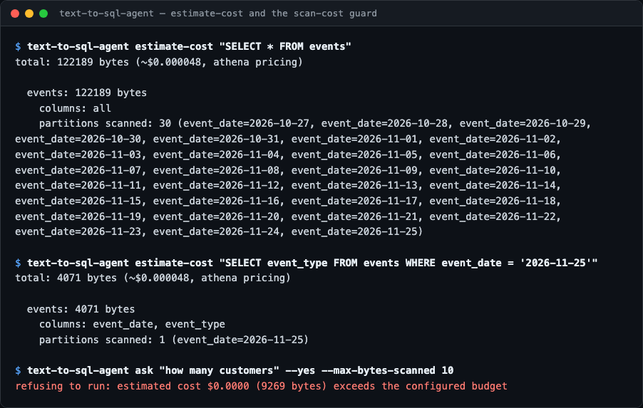

# text-to-sql-agent

[](https://github.com/tenalisriharsha/text-to-sql-agent/actions/workflows/ci.yml)

An agentic natural-language-to-SQL assistant. Ask a question in plain
English, and it retrieves the relevant tables from a schema catalog,
drafts a query, validates it against a strict safety contract (read-only,
single statement, table allowlist, enforced row limit), estimates what it
will cost to run, and only then executes it — with every step written to
an audit trace you can replay later.

It runs entirely offline against a generated sample warehouse on DuckDB,
with no API key required, and can translate validated queries to Athena
(Trino) or BigQuery SQL.

## Quick start

```bash
git clone https://github.com/tenalisriharsha/text-to-sql-agent.git
cd text-to-sql-agent
python3 -m venv .venv
source .venv/bin/activate
pip install -e .

text-to-sql-agent init-warehouse
text-to-sql-agent ask "how many customers" --yes
```

That generates a small sample warehouse (`customers`, `orders`, a
partitioned `events` click-stream) under `data/warehouse/`, then asks a
question against it. Drop `--yes` to see the human-approval prompt that
gates execution.

## Preview

| | |
|---|---|
|  |  |
|  |  |
|  |  |
|  |  |
|  | |

## How it works

```
question
   |
   v
SchemaCatalog  <---- warehouse (DuckDB / Parquet introspection)
   |
   v
SchemaRetriever.retrieve(question)  -- narrows the catalog to its top-k
   |                                   relevant tables/columns by TF-IDF
   |                                   cosine similarity (local, no API)
   v
LLMProvider.draft_sql(question, schema_context, correction?)
   v
validate_query()  --sqlglot AST checks--> reject, retry with error
   v
EXPLAIN on target engine  --engine error--> reject, retry with error
   v
scan-cost guard (bytes scanned -> pricing model -> USD, refuse or confirm)
   v
human approval (required unless --yes)
   v
execute -> results, all recorded to an audit trace
```

A rejected draft — invalid SQL, a table outside the allowlist, a
disallowed statement, or a query the target engine's `EXPLAIN` itself
rejects (an unknown column, a type mismatch) — feeds its error back into
the next draft attempt, up to a bounded number of retries, rather than
failing outright.

## Usage

```bash
# Generate the sample warehouse (customers, orders, events)
text-to-sql-agent init-warehouse [--output-dir data/warehouse] [--seed 42]

# Print the schema catalog built from it
text-to-sql-agent inspect-schema [--warehouse-dir data/warehouse]

# Rank tables/columns against a question and show the narrowed schema
# the agent loop would actually send to the provider
text-to-sql-agent retrieve "QUESTION" \
    [--warehouse-dir data/warehouse] \
    [--top-k-tables N] \
    [--top-k-columns N]

# Check SQL against the safety contract without running it
text-to-sql-agent validate "SELECT * FROM orders" [--warehouse-dir data/warehouse] [--row-limit N]

# Validate SQL, then show its partition/column-pruning-aware scan estimate
text-to-sql-agent estimate-cost "SELECT * FROM events WHERE event_date = '2026-01-01'" \
    [--warehouse-dir data/warehouse] \
    [--row-limit N] \
    [--pricing-model athena|bigquery]

# Ask a question
text-to-sql-agent ask "QUESTION" \
    [--warehouse-dir data/warehouse] \
    [--audit-log path/to/trace.jsonl] \
    [--yes] \
    [--target-dialect athena|bigquery] \
    [--max-correction-attempts N] \
    [--row-limit N] \
    [--top-k-tables N] \
    [--top-k-columns N] \
    [--pricing-model athena|bigquery] \
    [--max-bytes-scanned N] \
    [--max-cost-usd N]
```

`--yes` skips the human-approval prompt (useful for CI/scripted runs).
`--target-dialect` prints the validated query translated for another
engine instead of executing it against DuckDB. `--top-k-tables`/
`--top-k-columns` control how aggressively retrieval narrows the schema
context (defaults: top 2 tables, every column kept); if every table
scores zero against the question, retrieval falls back to the full
catalog rather than narrowing to nothing. `--pricing-model`/
`--max-bytes-scanned`/`--max-cost-usd` override the default `BudgetConfig`
for this run; the estimate behind them accounts for both partition
pruning (a `WHERE` filter on `events`' `event_date` only charges for the
partitions it can't rule out) and column pruning (a narrow `SELECT` list
only charges for the columns it references) — see `estimate-cost` to
inspect that estimate directly, independent of asking a question.

The bundled `ScriptedProvider` answers a fixed set of question patterns
deterministically — counts, an average, totals by status, group-bys, two
kinds of join, a window-function running total, and a relative-date time
filter — enough to exercise the full pipeline, including joins,
aggregates, a window function, and a time filter, without any model or
network access. It is meant to be swapped for a real LLM provider by
implementing `text_to_sql_agent.llm.base.LLMProvider`; both it and a
retrieved schema context are plumbed through
`text_to_sql_agent.agent.run_agent_loop`, the draft/validate/EXPLAIN/
retry loop `ask` runs, independent of the CLI.

## Safety contract

Every candidate query, however it was drafted, must pass
`text_to_sql_agent.sql.validator.validate_query` before it can run:

- Exactly one SQL statement — no `;`-separated multi-statement input.
- `SELECT` (or `UNION`/`EXCEPT`/`INTERSECT` of selects) only — no DDL or DML.
- Every referenced table must be on an explicit allowlist.
- A `LIMIT` is enforced: missing limits are added, oversized ones are
  clamped, both to a configurable row cap.

## Configuration

`text_to_sql_agent.config` defines the knobs an integration sets in code
(the CLI's `--pricing-model`/`--max-bytes-scanned`/`--max-cost-usd` flags
on `ask` and `estimate-cost` cover the common case without touching Python):

- `AgentConfig` — `max_correction_attempts`, `default_row_limit`,
  `require_human_approval`, `retrieval_top_k_tables`/
  `retrieval_top_k_columns_per_table` (both `None` means "keep all"), and a
  `BudgetConfig`.
- `BudgetConfig` — `max_bytes_scanned` and `max_cost_usd` (hard refusal
  ceilings), `confirm_above_usd` (a softer threshold below the ceiling,
  reserved for integrations building their own approval flow on top of this
  config — the bundled CLI's `ask` command always prompts for approval
  unless `--yes` is passed, regardless of this threshold), and a
  `pricing_model`.
- `PricingModel` — bytes-scanned pricing; `ATHENA_PRICING` ($5/TiB) and
  `BIGQUERY_PRICING` ($6.25/TiB) ship built in.

## Scan-cost guard

`text_to_sql_agent.cost_estimate.estimate_bytes_scanned` sizes a validated
query against the warehouse on disk, two ways:

- **Partition pruning** — for `events` (partitioned by `event_date`), it
  reads the query's `WHERE` clause for equality/`IN`/range predicates on
  the partition column and restricts the scan to the matching
  `event_date=...` directories instead of all of them.
- **Column pruning** — for every table, it reads the query's `SELECT`
  list, `WHERE`, `GROUP BY`, and `ORDER BY` to find which columns are
  actually referenced, then sums just those columns' compressed sizes from
  each Parquet file's own metadata instead of the whole file.

Both prunings fail safe: a predicate or column reference the estimator
can't resolve with confidence (an ambiguous unqualified column in a join,
a dynamic predicate like `CURRENT_DATE - INTERVAL`, a bare `*`) falls back
to charging for more bytes, never fewer. `ask` runs this automatically
before executing; `estimate-cost` runs it directly against any SQL string
for inspection.

## Status

This project is under active development. Phase 1 (project scaffold and
core foundation — schema catalog, sample warehouse generator, SQL
validator, pluggable LLM provider interface, audit trace, and the CLI
wiring them together), Phase 2 (local TF-IDF schema retrieval,
engine-error-driven self-correction via a real `EXPLAIN` check inside the
retry loop, and a broader `ScriptedProvider` difficulty curve), and
Phase 3 (the partition/column pruning-aware scan-cost guard above, and
`BudgetConfig`/`PricingModel` selection wired into the CLI) are complete.
Multi-engine execution and the evaluation harness are planned. See
[PROGRESS.md](PROGRESS.md) for the architecture, the full phased build
plan, and exactly what's done versus planned next.

## License

MIT — see [LICENSE](LICENSE).
