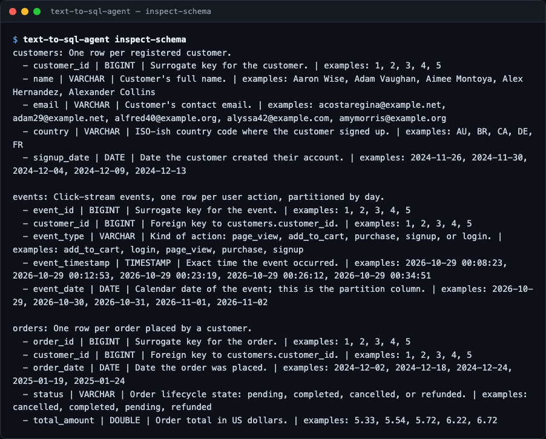
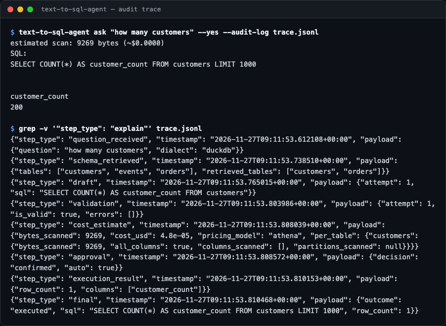
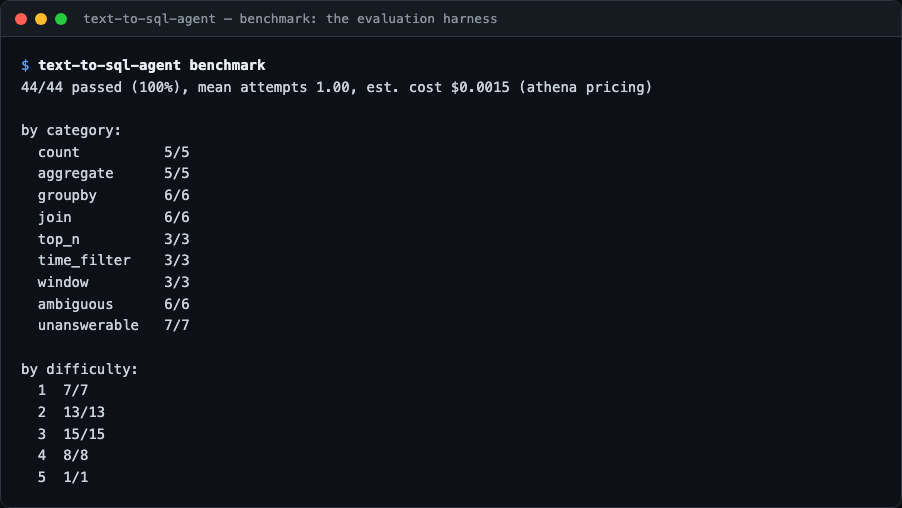
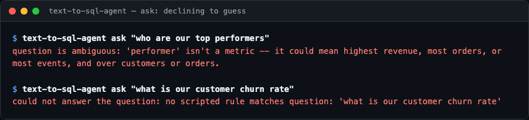

# text-to-sql-agent

[](https://github.com/tenalisriharsha/text-to-sql-agent/actions/workflows/ci.yml)

An agentic natural-language-to-SQL assistant. Ask a question in plain
English, and it retrieves the relevant tables from a schema catalog,
drafts a query, validates it against a strict safety contract (read-only,
single statement, table allowlist, enforced row limit), estimates what it
will cost to run, and only then executes it — with every step written to
an audit trace you can replay later.

It runs entirely offline against a generated sample warehouse on DuckDB,
with no API key required, and can also draft, validate, and execute
against Athena or BigQuery if you point it at an account of your own.

## Quick start

```bash
git clone https://github.com/tenalisriharsha/text-to-sql-agent.git
cd text-to-sql-agent
python3 -m venv .venv
source .venv/bin/activate
pip install -e .

text-to-sql-agent init-warehouse
text-to-sql-agent ask "how many customers" --yes
```

That generates a small sample warehouse (`customers`, `orders`, a
partitioned `events` click-stream) under `data/warehouse/`, then asks a
question against it. Drop `--yes` to see the human-approval prompt that
gates execution.

## Preview

| | |
|---|---|
|  |  |
|  |  |
|  |  |
|  |  |
|  |  |
|  | |

## How it works

```
question
   |
   v
SchemaCatalog  <---- warehouse (DuckDB / Parquet introspection)
   |
   v
SchemaRetriever.retrieve(question)  -- narrows the catalog to its top-k
   |                                   relevant tables/columns by TF-IDF
   |                                   cosine similarity (local, no API)
   v
LLMProvider.draft_sql(question, schema_context, correction?)
   |  -- ambiguous question (no stated metric/window/table) --> ask for
   |     clarification instead of guessing, no SQL drafted
   |  -- unrecognized question --> declined as unanswerable
   v
validate_query()  --sqlglot AST checks--> reject, retry with error
   v
EXPLAIN on target engine  --engine error--> reject, retry with error
   v
scan-cost guard (bytes scanned -> pricing model -> USD, refuse or confirm)
   v
human approval (required unless --yes)
   v
execute -> results, all recorded to an audit trace
```

A rejected draft — invalid SQL, a table outside the allowlist, a
disallowed statement, or a query the target engine's `EXPLAIN` itself
rejects (an unknown column, a type mismatch) — feeds its error back into
the next draft attempt, up to a bounded number of retries, rather than
failing outright.

## Usage

```bash
# Generate the sample warehouse (customers, orders, events)
text-to-sql-agent init-warehouse [--output-dir data/warehouse] [--seed 42]

# Print the schema catalog built from it
text-to-sql-agent inspect-schema [--warehouse-dir data/warehouse]

# Rank tables/columns against a question and show the narrowed schema
# the agent loop would actually send to the provider
text-to-sql-agent retrieve "QUESTION" \
    [--warehouse-dir data/warehouse] \
    [--top-k-tables N] \
    [--top-k-columns N]

# Check SQL against the safety contract without running it
text-to-sql-agent validate "SELECT * FROM orders" [--warehouse-dir data/warehouse] [--row-limit N]

# Validate SQL, then show its partition/column-pruning-aware scan estimate
text-to-sql-agent estimate-cost "SELECT * FROM events WHERE event_date = '2026-01-01'" \
    [--warehouse-dir data/warehouse] \
    [--row-limit N] \
    [--pricing-model athena|bigquery]

# Run the bundled benchmark and score it
text-to-sql-agent benchmark \
    [--warehouse-dir data/warehouse] \
    [--category count|aggregate|groupby|join|top_n|time_filter|window|ambiguous|unanswerable ...] \
    [--pricing-model athena|bigquery] \
    [--output report.json] \
    [--max-correction-attempts N] \
    [--top-k-tables N] \
    [--top-k-columns N]

# Ask a question
text-to-sql-agent ask "QUESTION" \
    [--warehouse-dir data/warehouse] \
    [--dialect duckdb|athena|bigquery] \
    [--audit-log path/to/trace.jsonl] \
    [--yes] \
    [--target-dialect duckdb|athena|bigquery] \
    [--max-correction-attempts N] \
    [--row-limit N] \
    [--top-k-tables N] \
    [--top-k-columns N] \
    [--pricing-model athena|bigquery] \
    [--max-bytes-scanned N] \
    [--max-cost-usd N] \
    [--athena-s3-staging-dir s3://bucket/path] \
    [--athena-region us-east-1] \
    [--athena-schema default] \
    [--athena-workgroup name] \
    [--bigquery-project my-gcp-project] \
    [--bigquery-location US]
```

`--dialect` chooses where drafting, `EXPLAIN`, and execution actually
happen: `duckdb` (the default) runs against the local sample warehouse;
`athena`/`bigquery` run against your own account instead (see
[Execution engines](#execution-engines) below). `--yes` skips the
human-approval prompt, but only for `--dialect duckdb` — Athena and
BigQuery always require interactive approval, since they're not the
bundled demo source. `--target-dialect` prints the validated query
translated for another engine instead of executing it anywhere.
`--top-k-tables`/`--top-k-columns` control how aggressively retrieval
narrows the schema context (defaults: top 2 tables, every column kept);
if every table scores zero against the question, retrieval falls back to
the full catalog rather than narrowing to nothing. `--pricing-model`/
`--max-bytes-scanned`/`--max-cost-usd` override the default `BudgetConfig`
for this run; the estimate behind them accounts for both partition
pruning (a `WHERE` filter on `events`' `event_date` only charges for the
partitions it can't rule out) and column pruning (a narrow `SELECT` list
only charges for the columns it references) — see `estimate-cost` to
inspect that estimate directly, independent of asking a question. This
scan-cost guard only runs for `--dialect duckdb`; see
[Execution engines](#execution-engines) for why.

The bundled `ScriptedProvider` answers a fixed set of question patterns
deterministically — counts, an average, totals by status, group-bys, two
kinds of join, a window-function running total, and a relative-date time
filter — enough to exercise the full pipeline, including joins,
aggregates, a window function, and a time filter, without any model or
network access. It is meant to be swapped for a real LLM provider by
implementing `text_to_sql_agent.llm.base.LLMProvider`; both it and a
retrieved schema context are plumbed through
`text_to_sql_agent.agent.run_agent_loop`, the draft/validate/EXPLAIN/
retry loop `ask` runs, independent of the CLI.

It also recognizes a second kind of question it deliberately declines to
guess at: a handful of phrasings ("top performers", "recent activity",
"how is the business doing", ...) are recognizable but genuinely
under-specified — no stated metric, time window, or table — so instead of
silently picking one interpretation, `draft_sql` raises
`ClarificationNeededError` with the ambiguity and a few concrete
rephrasings that *would* resolve it. `ask` surfaces this as "question is
ambiguous: ..." and exits non-zero rather than running a query that might
answer a different question than the one asked.

## Safety contract

Every candidate query, however it was drafted, must pass
`text_to_sql_agent.sql.validator.validate_query` before it can run:

- Exactly one SQL statement — no `;`-separated multi-statement input.
- `SELECT` (or `UNION`/`EXCEPT`/`INTERSECT` of selects) only — no DDL or DML.
- Every referenced table must be on an explicit allowlist.
- A `LIMIT` is enforced: missing limits are added, oversized ones are
  clamped, both to a configurable row cap.

## Configuration

`text_to_sql_agent.config` defines the knobs an integration sets in code
(the CLI's `--pricing-model`/`--max-bytes-scanned`/`--max-cost-usd` flags
on `ask` and `estimate-cost` cover the common case without touching Python):

- `AgentConfig` — `max_correction_attempts`, `default_row_limit`,
  `require_human_approval`, `retrieval_top_k_tables`/
  `retrieval_top_k_columns_per_table` (both `None` means "keep all"), and a
  `BudgetConfig`.
- `BudgetConfig` — `max_bytes_scanned` and `max_cost_usd` (hard refusal
  ceilings), `confirm_above_usd` (a softer threshold below the ceiling,
  reserved for integrations building their own approval flow on top of this
  config — the bundled CLI's `ask` command always prompts for approval
  unless `--yes` is passed, regardless of this threshold), and a
  `pricing_model`.
- `PricingModel` — bytes-scanned pricing; `ATHENA_PRICING` ($5/TiB) and
  `BIGQUERY_PRICING` ($6.25/TiB) ship built in.

## Scan-cost guard

`text_to_sql_agent.cost_estimate.estimate_bytes_scanned` sizes a validated
query against the warehouse on disk, two ways:

- **Partition pruning** — for `events` (partitioned by `event_date`), it
  reads the query's `WHERE` clause for equality/`IN`/range predicates on
  the partition column and restricts the scan to the matching
  `event_date=...` directories instead of all of them.
- **Column pruning** — for every table, it reads the query's `SELECT`
  list, `WHERE`, `GROUP BY`, and `ORDER BY` to find which columns are
  actually referenced, then sums just those columns' compressed sizes from
  each Parquet file's own metadata instead of the whole file.

Both prunings fail safe: a predicate or column reference the estimator
can't resolve with confidence (an ambiguous unqualified column in a join,
a dynamic predicate like `CURRENT_DATE - INTERVAL`, a bare `*`) falls back
to charging for more bytes, never fewer. `ask` runs this automatically
before executing; `estimate-cost` runs it directly against any SQL string
for inspection.

## Evaluation harness

`text_to_sql_agent.evaluation.benchmark.BENCHMARK` is a fixed set of 44
natural-language questions spanning the difficulty curve `ScriptedProvider`
supports — counts, aggregates, group-bys, two kinds of join, a top-N
ranking, a relative-date time filter, and a window function, each via
several independent phrasings — plus questions that should *not* get a
query at all: six genuinely ambiguous ones (no stated metric, time window,
or table) and seven unanswerable ones (asking about data the warehouse
doesn't have, like products or employees). Every question carries what the
*correct* outcome is: a `"success"` question carries its own `expected_sql`
(authored independently of `ScriptedProvider`, not copied from it) to check
rows against; a `"clarification"` or `"unanswerable"` question just checks
that the agent reached that outcome instead of answering.

```bash
text-to-sql-agent benchmark
```

runs every question through the exact same draft/validate/EXPLAIN loop
`ask` runs — against the local DuckDB warehouse only, since this measures
the pipeline itself (retrieval, drafting, validation, self-correction,
scan cost) rather than any particular cloud account — and reports pass/fail
by category and difficulty, mean correction attempts, and total estimated
cost. `--category` restricts to one or more categories (repeatable),
`--output` writes the full per-question breakdown as JSON, and
`--pricing-model`/`--max-correction-attempts`/`--top-k-tables`/
`--top-k-columns` match the same-named options on `ask`. It exits non-zero
if any question fails.

## Execution engines

`ask --dialect` picks which engine actually drafts against, runs
`EXPLAIN` on, and executes the query — DuckDB (the bundled demo source),
or Athena/BigQuery if you supply connection details for an account of
your own:

```bash
text-to-sql-agent ask "how many customers" \
    --dialect athena \
    --athena-s3-staging-dir s3://my-bucket/athena-results/ \
    --athena-region us-east-1

text-to-sql-agent ask "how many customers" \
    --dialect bigquery \
    --bigquery-project my-gcp-project
```

Both require an optional extra — `pyathena` or `google-cloud-bigquery`
aren't installed by default, so the no-API-key, no-cloud-account default
install stays dependency-light:

```bash
pip install -e ".[athena]"     # pyathena
pip install -e ".[bigquery]"   # google-cloud-bigquery
```

The schema catalog and table allowlist always come from the local sample
warehouse, regardless of `--dialect` — retrieval and validation are about
*which* tables and columns a query may reference, not *where* it runs.
That means pointing `ask` at Athena or BigQuery assumes your account
already has tables named `customers`, `orders`, and `events` with
matching columns; it does not create or upload anything for you.

The scan-cost guard (`estimate_bytes_scanned`) sizes the *local* sample
warehouse's Parquet files on disk, which only stands in for a real
engine's cost when that engine is the local demo itself — there's no
local file to size for a query that actually runs on your own Athena or
BigQuery account, so the guard is skipped for those dialects and
`ask` falls back to the `EXPLAIN` step as the cost signal instead: for
BigQuery this is a real dry-run bytes-processed estimate (BigQuery has no
`EXPLAIN` statement, so the adapter runs the query as a dry run and
reports `total_bytes_processed`); for Athena/Trino it's the query plan
text, since Trino's `EXPLAIN` doesn't expose a bytes-scanned estimate the
way a dry run does. Non-`duckdb` dialects always require interactive
approval as a result — `--yes` is ignored.

Both adapters (`text_to_sql_agent.engines.athena_engine.AthenaConnection`,
`text_to_sql_agent.engines.bigquery_engine.BigQueryConnection`) raise
`text_to_sql_agent.engines.base.EngineExecutionError` — never a raw driver
exception — for both a missing optional dependency and a failed query, so
callers only need to catch one exception type regardless of which engine
they're talking to. They satisfy the same narrow `Connection` interface
DuckDB's native connection already does (`execute(sql)` returning
something with `.description`/`.fetchall()`), which is why
`text_to_sql_agent.agent.run_agent_loop` works against any of the three
unmodified.

## Status

Feature-complete: schema catalog and retrieval, the pluggable
`ScriptedProvider` with ambiguity detection, the SQL safety contract, the
partition/column-pruning-aware scan-cost guard, Athena/BigQuery execution
adapters, the audit trace, and the 44-question evaluation harness are all
implemented, tested, and exercised end to end against the bundled sample
warehouse. See [PROGRESS.md](PROGRESS.md) for the architecture and the
full phased build history, and [DAILY_REPORT.md](DAILY_REPORT.md) for a
summary of what was built, test results, and known limitations.
Plugging in a real (non-scripted) `LLMProvider` is the natural next step
for anyone extending this.

## License

MIT — see [LICENSE](LICENSE).
