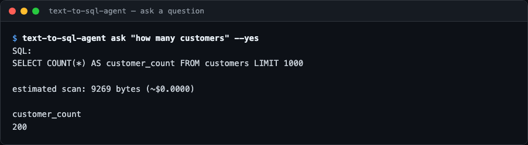
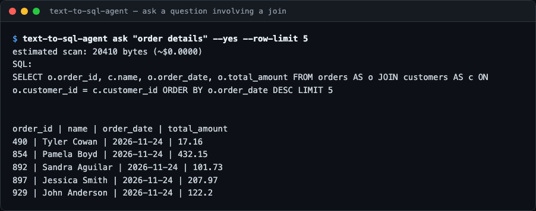

# text-to-sql-agent

[](https://github.com/tenalisriharsha/text-to-sql-agent/actions/workflows/ci.yml)

An agentic natural-language-to-SQL assistant. Ask a question in plain
English, and it retrieves the relevant tables from a schema catalog,
drafts a query, validates it against a strict safety contract (read-only,
single statement, table allowlist, enforced row limit), estimates what it
will cost to run, and only then executes it — with every step written to
an audit trace you can replay later.

It runs entirely offline against a generated sample warehouse on DuckDB,
with no API key required, and can translate validated queries to Athena
(Trino) or BigQuery SQL.

## Quick start

```bash
git clone https://github.com/tenalisriharsha/text-to-sql-agent.git
cd text-to-sql-agent
python3 -m venv .venv
source .venv/bin/activate
pip install -e .

text-to-sql-agent init-warehouse
text-to-sql-agent ask "how many customers" --yes
```

That generates a small sample warehouse (`customers`, `orders`, a
partitioned `events` click-stream) under `data/warehouse/`, then asks a
question against it. Drop `--yes` to see the human-approval prompt that
gates execution.

## Preview

| | |
|---|---|
|  |  |
|  |  |
|  |  |

## How it works

```
question
   |
   v
SchemaCatalog  <---- warehouse (DuckDB / Parquet introspection)
   v
LLMProvider.draft_sql(question, schema_context, correction?)
   v
validate_query()  --sqlglot AST checks--> reject, retry with error
   v
EXPLAIN on target engine
   v
scan-cost guard (bytes scanned -> pricing model -> USD, refuse or confirm)
   v
human approval (required unless --yes)
   v
execute -> results, all recorded to an audit trace
```

A rejected draft (bad SQL, a table outside the allowlist, a disallowed
statement) feeds its error back into the next draft attempt, up to a
bounded number of retries, rather than failing outright.

## Usage

```bash
# Generate the sample warehouse (customers, orders, events)
text-to-sql-agent init-warehouse [--output-dir data/warehouse] [--seed 42]

# Print the schema catalog built from it
text-to-sql-agent inspect-schema [--warehouse-dir data/warehouse]

# Check SQL against the safety contract without running it
text-to-sql-agent validate "SELECT * FROM orders" [--warehouse-dir data/warehouse] [--row-limit N]

# Ask a question
text-to-sql-agent ask "QUESTION" \
    [--warehouse-dir data/warehouse] \
    [--audit-log path/to/trace.jsonl] \
    [--yes] \
    [--target-dialect athena|bigquery] \
    [--max-correction-attempts N] \
    [--row-limit N]
```

`--yes` skips the human-approval prompt (useful for CI/scripted runs).
`--target-dialect` prints the validated query translated for another
engine instead of executing it against DuckDB.

The bundled `ScriptedProvider` answers a fixed set of question patterns
deterministically (counts, totals by status, group-bys, a join, a
"top customers" query) — enough to exercise the full pipeline without any
model or network access. It is meant to be swapped for a real LLM provider
by implementing `text_to_sql_agent.llm.base.LLMProvider`.

## Safety contract

Every candidate query, however it was drafted, must pass
`text_to_sql_agent.sql.validator.validate_query` before it can run:

- Exactly one SQL statement — no `;`-separated multi-statement input.
- `SELECT` (or `UNION`/`EXCEPT`/`INTERSECT` of selects) only — no DDL or DML.
- Every referenced table must be on an explicit allowlist.
- A `LIMIT` is enforced: missing limits are added, oversized ones are
  clamped, both to a configurable row cap.

## Configuration

`text_to_sql_agent.config` defines the knobs an integration sets in code:

- `AgentConfig` — `max_correction_attempts`, `default_row_limit`,
  `require_human_approval`, and a `BudgetConfig`.
- `BudgetConfig` — `max_bytes_scanned` and `max_cost_usd` (hard refusal
  ceilings), `confirm_above_usd` (a softer threshold below the ceiling,
  reserved for integrations building their own approval flow on top of this
  config — the bundled CLI's `ask` command always prompts for approval
  unless `--yes` is passed, regardless of this threshold), and a
  `pricing_model`.
- `PricingModel` — bytes-scanned pricing; `ATHENA_PRICING` ($5/TiB) and
  `BIGQUERY_PRICING` ($6.25/TiB) ship built in.

## Project status

This project is under active development. See [PROGRESS.md](PROGRESS.md)
for the architecture, the full phased build plan, and exactly what's done
versus planned next.

## Status

Phase 1 (project scaffold and core foundation — schema catalog, sample
warehouse generator, SQL validator, pluggable LLM provider interface,
audit trace, and the CLI wiring them together) is complete. Embedding-based
schema retrieval, engine-error-driven self-correction, a partition/column
pruning-aware scan-cost guard, multi-engine execution, and the evaluation
harness are planned — see [PROGRESS.md](PROGRESS.md).

## License

MIT — see [LICENSE](LICENSE).
